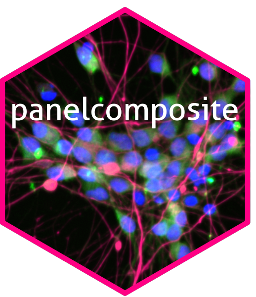

# panelcomposite 

# 1 Introduction

`panelcomposite` is a small R package for compositing images into
figures. It has been developed for the context of fluorescent
immunocytochemistry or immunohistochemistry. As with `ggDNAvis`, there
are a few main user-facing functions and a lot of helper functions that
users shouldn’t need to interface with, but are exported anyway in case
they’re ever useful.
